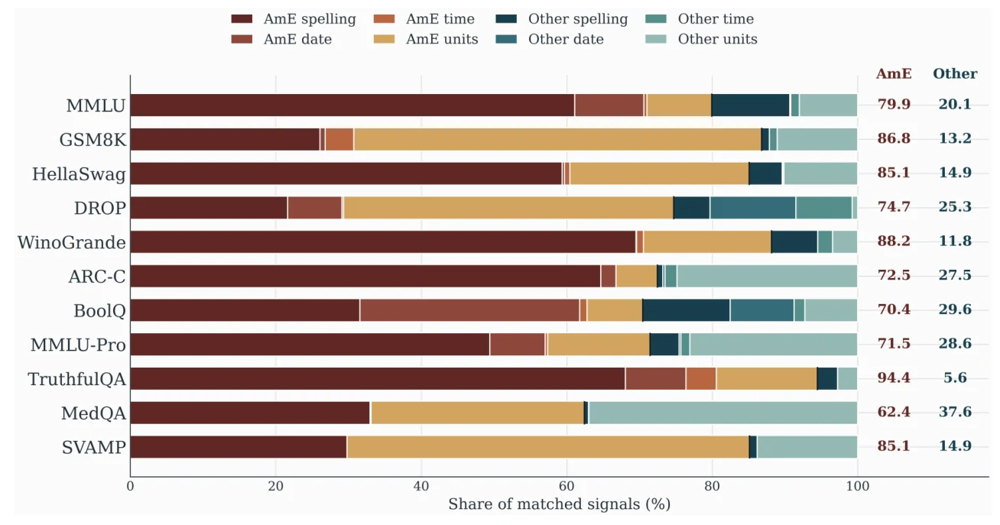

# Text convention audit

The audit matches selected spelling, date, time, and measurement forms in 11 text benchmarks. American-centered forms account for **62.4% to 94.4% of matched signals**. This denominator is detected signals, not all benchmark items or users. The detector inventory is in [`data/convention_detector_inventory/`](../../data/convention_detector_inventory/).

*Figure 1 of the paper. The detailed [PDF figure](figures/category_panels_by_benchmark.pdf), [match-share CSV](tables/convention_summary/convention_summary_match_share_by_type.csv), and [item-coverage CSV](tables/convention_summary/convention_summary_flagged_rate.csv) are included here.*

| Benchmark | Items with a matched signal | American-centered share of matched signals |
| --- | ---: | ---: |
| MMLU | 26.60% | 79.94% |
| GSM8K | 25.40% | 86.79% |
| HellaSwag | 38.11% | 85.07% |
| DROP | 78.08% | 74.70% |
| WinoGrande | 5.97% | 88.15% |
| ARC-Challenge | 18.73% | 72.46% |
| BoolQ | 44.92% | 70.44% |
| MMLU-Pro | 37.80% | 71.45% |
| TruthfulQA | 7.59% | 94.44% |
| MedQA | 65.85% | 62.41% |
| SVAMP | 9.30% | 85.11% |

The two columns use **different denominators**: item coverage versus shares among matches. Excluding spelling, American-centered forms remain a majority in eight of 11 resources; see the [project site's benchmark table](https://tafseer-nayeem.github.io/WhoseBench/#conventions) and the [category-level CSV](tables/convention_summary/category_panel_values.csv). This is a pattern in observable forms, not an inference about user identities.

The [`tables/`](tables/) directory also includes benchmark/provider variation summaries and term frequencies. [`scripts/convention/`](../../scripts/convention/) contains acquisition and scanning code. Scorer-side consequences of valid answer variants are documented separately in the [sensitivity results](../evaluation_sensitivity_broad/README.md).
