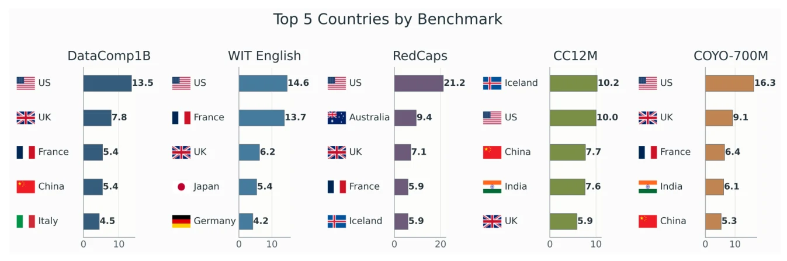
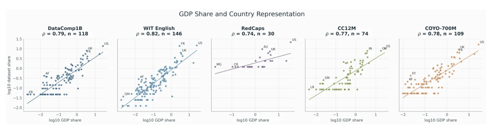

# Geographic visibility audit

This analysis resolves explicit country references in captions or associated text from DataComp1B, WIT English, RedCaps, CC12M, and COYO-700M. A resolved reference is **textual visibility**, not proof of where an image was taken. The United States leads four resources; Iceland leads CC12M.

*Figure 2 of the paper; values come from the [top-five CSV](tables/country_figures/top5_by_benchmark.csv).*

| Resource | Most referenced country | Share of resolved assignments |
| --- | --- | ---: |
| DataComp1B | United States | 13.5% |
| WIT English | United States | 14.6% |
| RedCaps | United States | 21.2% |
| CC12M | Iceland | 10.2% |
| COYO-700M | United States | 16.3% |

The top three countries account for 26.8% to 37.6% of resolved assignments across resources. The [country-figure tables](tables/country_figures/) and [country PDF figures](figures/country_figures/) retain the fuller distribution.

*Figure 3 of the paper. Associations are descriptive, not causal.*

For the population-at-least-1-million setting, the mean correlation of country visibility with GDP share across five resources is **Pearson r = 0.780** and **Spearman rho = 0.778**. The corresponding mean unweighted OLS R-squared is **0.614**. See the [setting summary](tables/gdp_representation_v2/gdp_representation_v2_setting_summary.csv), [per-resource detail](tables/gdp_representation_v2/gdp_representation_v2_setting_detail.csv), [control-model summary](tables/gdp_representation_v2/gdp_representation_v2_model_summary.csv), and [PDF figures](figures/gdp_representation_v2/). The study also reports a balanced WIT comparison on the [project site](https://tafseer-nayeem.github.io/WhoseBench/#geography).

The released [country lexicon](../../data/country_resolver_lexicons/) is the appropriate input for reproducing these tables. Raw captions and images are not bundled; see [source boundaries](../../DATA_SOURCES.md).
